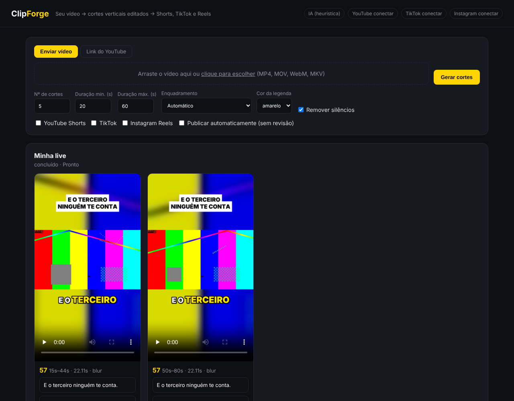

# ClipForge: do seu vídeo a Shorts, TikTok e Reels

App web **de uso pessoal**. Você envia um vídeo (ou cola um link do YouTube) e o ClipForge:

1. **Recebe** o arquivo enviado (MP4, MOV, WebM, MKV) ou **baixa** o vídeo do link (yt-dlp, até 1080p).
2. **Transcreve** com timestamps de cada palavra (faster-whisper, roda local).
3. **Escolhe os melhores momentos** com o Claude: trechos com gancho forte, que fazem sentido sozinhos e terminam numa conclusão. Também gera o título de gancho, o título do post, a legenda e as hashtags. Sem chave da API, usa uma heurística simples.
4. **Edita cada corte** em 1080×1920:
   - enquadramento vertical que **segue o rosto** de quem fala, trocando de plano com corte seco, sem tremedeira. Quando não há rosto (tela, slides, jogo), usa o vídeo inteiro sobre um **fundo desfocado**;
   - **jump cuts**: remove silêncios e pausas longas;
   - **punch-in** (zoom de 8%) alternado a cada jump cut;
   - **legendas animadas** palavra por palavra, em caixa alta, com destaque colorido e efeito de "pop";
   - **título-gancho** no topo nos 3 primeiros segundos;
   - **barra de progresso** no rodapé;
   - áudio **normalizado em -14 LUFS**, o padrão das plataformas.
5. **Publica** no YouTube Shorts, no TikTok e no Instagram Reels, automaticamente ou depois de você revisar e editar o texto na interface.



## Treino de Oratória

Um app para treinar a fala em público, em `oratoria/index.html`. Com o servidor rodando, abra **http://localhost:8000/oratoria**. O arquivo também abre sozinho, sem servidor; nesse caso só a análise por IA fica desligada.

- **Modos:** improviso com tema surpresa, tema livre, discurso com roteiro (teleprompter), pitch de vendas e dicção com trava-línguas.
- **Durante o treino:** grava câmera e microfone, mostra a transcrição ao vivo, as palavras por minuto, os vícios de linguagem destacados ("é…", "tipo", "né", "então"…), as pausas longas e o volume.
- **No final:** uma nota de 0 a 100 dividida em ritmo, clareza, fluência, expressividade da voz e controle do tempo, com dicas práticas. Você pode baixar o vídeo e pedir o feedback de um coach gerado pelo Claude (precisa de `ANTHROPIC_API_KEY`; só o texto é enviado).
- **Evolução:** o histórico e o gráfico das notas ficam salvos no navegador. A aba Exercícios traz uma rotina diária de 10 minutos.

**Onde funciona:**
- **iPhone:** abra pelo endereço `https://…/oratoria` do servidor, no Safari. O iPhone só libera câmera e microfone em HTTPS. Com o servidor, a fala é transcrita no final do treino pelo Whisper, o mesmo motor dos cortes, sem depender do Ditado do iPhone. Sem o servidor, a transcrição usa o Ditado do iOS (Ajustes › Geral › Teclado › Ativar Ditado) e só funciona no Safari: o Chrome e outros apps do iPhone não têm reconhecimento de voz.
- **Android e computador:** Chrome ou Edge, com transcrição ao vivo.
- Se `APP_PASSWORD` estiver definida, o login volta direto para `/oratoria`.

## Instalação

Requisitos: Python 3.10+ e **ffmpeg** com libass (`apt install ffmpeg` ou `brew install ffmpeg`).

```bash
python -m venv .venv && source .venv/bin/activate
pip install -r requirements.txt
cp .env.example .env        # preencha as chaves (veja abaixo)
python -m clipforge serve   # abra http://localhost:8000
```

### Usar no celular

1. Abra o endereço do app no navegador do celular e entre com a senha.
2. **Instale na tela inicial:** no Android (Chrome), use o menu ⋮ → *Instalar app*; no iPhone (Safari), use Compartilhar → *Adicionar à Tela de Início*.
3. **Android:** depois de instalado, o ClipForge aparece no menu **Compartilhar**. No app do YouTube, toque em Compartilhar → ClipForge e os cortes começam. Na Galeria, compartilhe um vídeo → ClipForge.

O app precisa estar rodando num servidor ou no seu computador (veja abaixo).

**Servidor próprio (VPS) com HTTPS automático:** contrate um VPS Ubuntu (mínimo 4 vCPU e 8 GB de RAM), aponte um domínio para o IP dele e rode:
```bash
curl -fsSL https://raw.githubusercontent.com/lucassrr92-afk/Videos/claude/clipforge/deploy.sh | DOMAIN=cortes.seudominio.com bash
```
O script instala o Docker, sobe o app com certificado HTTPS e mostra a senha de acesso gerada.

**No seu computador, acessando pelo celular:** rode `python -m clipforge serve` e, em outro terminal, `cloudflared tunnel --url http://localhost:8000`. O cloudflared mostra um endereço `https://….trycloudflare.com`. Abra esse endereço no celular, e lembre de definir `APP_PASSWORD`.

### Usar pela internet (detalhes)

Hospede num servidor (VPS) ou deixe rodando no seu computador com um túnel (Cloudflare Tunnel, ngrok). **Defina `APP_PASSWORD` no `.env`**: com ela, o app pede senha antes de qualquer coisa. Use HTTPS (o túnel ou um proxy como Caddy já fornecem) e ajuste `PUBLIC_BASE_URL` para o endereço público. Isso também é necessário para o login do TikTok, que exige HTTPS.

Com Docker: `docker build -t clipforge . && docker run -p 8000:8000 --env-file .env -v $PWD/data:/app/data -v $PWD/tokens:/app/tokens clipforge`

Linha de comando, sem interface:

```bash
python -m clipforge "https://www.youtube.com/watch?v=XXXX" --clips 6 --max-len 45 --publish youtube,tiktok
```

Os cortes ficam em `data/jobs/<id>/corte_XX.mp4`.

> Dica: uma GPU NVIDIA deixa a transcrição muito mais rápida (`WHISPER_DEVICE=cuda`, `WHISPER_MODEL=large-v3`). Em CPU, `small` é um bom equilíbrio entre velocidade e qualidade.

## Configurando as contas

### IA (Claude)
Crie uma chave em https://console.anthropic.com e coloque em `ANTHROPIC_API_KEY`. Sem a chave o app funciona, mas a escolha dos cortes é bem pior.

### YouTube Shorts
1. No [Google Cloud Console](https://console.cloud.google.com), crie um projeto e ative a **YouTube Data API v3**.
2. Configure a tela de consentimento OAuth e adicione seu e-mail como usuário de teste.
3. Crie uma credencial **OAuth client ID → Web application** com o redirect `http://localhost:8000/auth/youtube/callback`.
4. Baixe o JSON como `client_secret.json` na raiz do projeto.
5. Na interface, clique em **YouTube conectar**.

Para uso pessoal, deixe o app OAuth em modo "Teste" com seu e-mail como usuário de teste. Nesse modo o login expira a cada 7 dias: é só clicar em conectar de novo. Projetos não verificados podem ter os uploads travados como **privados**; se acontecer, peça a auditoria da YouTube API. A cota padrão permite cerca de 6 uploads por dia.

### TikTok
1. Em https://developers.tiktok.com crie um app e adicione os produtos **Login Kit** e **Content Posting API** (com *Direct Post*).
2. Escopos: `user.info.basic` e `video.publish`. Redirect URI: `http://localhost:8000/auth/tiktok/callback`. O TikTok pode exigir HTTPS; nesse caso use um túnel como ngrok ou cloudflared e ajuste `PUBLIC_BASE_URL`.
3. Preencha `TIKTOK_CLIENT_KEY` e `TIKTOK_CLIENT_SECRET` e clique em **TikTok conectar**.

Atenção: até o TikTok auditar o app, os posts só podem ser **privados (SELF_ONLY)**. O app ajusta isso sozinho. Depois da auditoria, ficam públicos.

### Instagram Reels
1. A conta do Instagram precisa ser **Business ou Creator** e estar ligada a uma Página do Facebook.
2. Crie um app em https://developers.facebook.com (tipo Business), adicione o produto **Facebook Login** com o redirect `<PUBLIC_BASE_URL>/auth/instagram/callback` e preencha `META_APP_ID` e `META_APP_SECRET`.
3. Na interface, clique em **Instagram conectar**. Como é só a sua conta (você é administrador do app), funciona em modo desenvolvimento, **sem App Review**.
4. O upload é *resumable*, então não precisa hospedar o vídeo em URL pública.

Alternativa sem login: preencha `IG_USER_ID` e `IG_ACCESS_TOKEN` (token de longa duração gerado no Graph API Explorer).

## Personalização
- Fontes: coloque arquivos `.ttf`/`.otf` (ex.: Montserrat ExtraBold, Anton, The Bold Font) em `fonts/` e mude `font` em `DEFAULT_OPTIONS` (`clipforge/jobs.py`).
- Estilo das legendas: `clipforge/pipeline/subtitles.py` (cores, tamanho, quantidade de palavras por bloco).
- Critérios de escolha dos cortes: `SYSTEM_PROMPT` em `clipforge/pipeline/highlights.py`.

## Estrutura

```
clipforge/
  app.py               servidor web (FastAPI): upload, senha de acesso, rotas OAuth
  accounts.py          tokens das redes (criptografáveis com TOKENS_ENCRYPTION_KEY)
  jobs.py              fila e orquestração (download → transcrição → cortes → render → publicação)
  pipeline/
    download.py        yt-dlp
    transcribe.py      faster-whisper com timestamps por palavra
    highlights.py      escolha dos momentos (Claude, saída JSON estruturada)
    reframe.py         detecção de rosto e planos para o crop 9:16
    subtitles.py       legendas ASS animadas e título-gancho
    render.py          filtergraph do ffmpeg (jump cuts, crop/blur, zoom, legendas, loudnorm)
  publishers/
    youtube.py  tiktok.py  instagram.py
  templates/index.html interface
```

## Avisos
- Só corte e publique vídeos **seus** ou que você tenha autorização para usar. Repostar conteúdo de terceiros pode gerar strike de direitos autorais e banimento da conta.
- Baixar vídeos do YouTube pode violar os Termos de Serviço da plataforma, exceto quando o conteúdo é seu. Por isso o envio do arquivo é o caminho principal.
- Depois que os cortes ficam prontos, o vídeo original é apagado do servidor para economizar espaço (a transcrição fica guardada).
- Publicar o mesmo vídeo em massa sem revisão pode ser tratado como spam pelas plataformas. Por isso o padrão é **revisar antes de publicar**.
